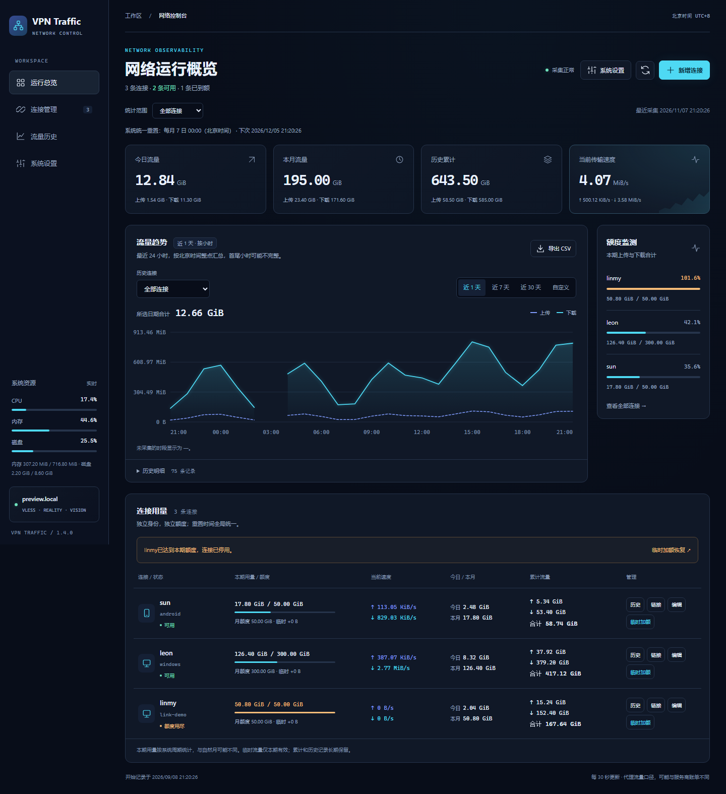

# VPN Traffic

为现有 Xray VLESS + REALITY 和 HTTPS 私人订阅部署提供每身份流量统计、历史记录、网页新增连接和月度配额管理。安装包为 `Architecture: all`，应用仅使用 Python 标准库；不包含服务器凭据，也不安装 Xray 本身。

## 控制台界面

v1.4.0 使用深色控制台、青蓝色趋势图和额度监测面板；侧栏选中项使用低对比度底色，没有左侧亮色竖线。手机上连接用量重排为卡片，保留全部统计字段和管理入口。



## 项目文档

- [技术方案说明](docs/technical-design.md)：整体架构、流量账本、统一月度重置、临时加额、历史查询、数据模型、API、部署和维护。
- [离线 HTML 技术方案](docs/technical-design.html)：下载后用浏览器打开，支持目录导航、配色切换和打印 / 保存 PDF。
- [CI 与版本发布](docs/releasing.md)：自动检查、版本标签及 GitHub Release 附件。
- [版本变更](CHANGELOG.md)。

## 安装

支持使用 systemd 的 Debian/Ubuntu，需要已有以下部署结构：

- Xray：`/usr/local/bin/xray`、`/usr/local/etc/xray/config.json`、`xray.service`。
- 每个 VLESS 用户有唯一 `email` 标识。
- `/root/xray-deployment/manifest.json` 和 `backup.sh`。
- `/usr/local/sbin/xray-subscription` 及 `/etc/nginx/sites-available/xray-subscription.conf`，已配置 HTTPS 8443。

```sh
sha256sum -c vpn-traffic_1.4.0_all.deb.sha256
sudo apt install ./vpn-traffic_1.4.0_all.deb
sudo vpn-traffic web-password
```

网页入口：`https://服务器IP:8443/traffic/`。用户名和随机密码通过最后一条命令查看。安装时配置校验通过后会重启一次 Xray，原节点链接与订阅地址保持有效。

升级或重新安装沿用原数据库和登录密码。安装前的配置快照保存在 `/var/backups/vpn-traffic/before-*`，权限为 root 专用；这类快照包含服务器私钥，不能公开。

## 查询与维护

```sh
sudo vpn-traffic show
sudo vpn-traffic status
sudo vpn-traffic history --from 2026-11-01 --to 2026-11-07 --device android
sudo vpn-traffic export --from 2026-11-01 --to 2026-11-07 --output /root/traffic.csv
sudo vpn-traffic checkpoint
sudo vpn-traffic schedule-update --reset-day 15 --reset-time 09:30
sudo vpn-traffic link-create --label "家人手机" --quota-gib 20
sudo vpn-traffic link-update --device link-xxx --quota-gib 50
sudo vpn-traffic link-bonus --device link-xxx --amount-gib 5
sudo vpn-traffic link-sharing --device link-xxx
sudo vpn-traffic link-reset --device link-xxx
sudo vpn-traffic link-revoke --device link-xxx
sudo vpn-traffic web-password --reset
systemctl status vpn-traffic-collector vpn-traffic-web --no-pager
journalctl -u vpn-traffic-collector -n 30 --no-pager
```

`checkpoint` 在正常 Xray 停止或重启之前由 systemd 自动调用。采集器故障时不会阻止 Xray 停止。网页需要 HTTPS Basic 登录，管理请求另有同源和 CSRF 校验；未记录访问目标、内容或用户来源 IP。

## 新增连接、月度额度与重置计划

- 网页“新增连接”可设置名称、月度额度和启用状态。新连接生成独立 UUID、Short ID、VLESS 链接和在线订阅。
- 配额按上传和下载合计，0 表示不限额，网页额度单位为 GiB。升级保留已经设置的额度、本期已用量和历史记录。
- 所有连接共用一个系统重置计划，在右上角“系统设置”中修改。按北京时间执行，可选每月 1–31 日与 HH:MM；不存在的日期按月末处理，后续月份仍沿用原设置日。
- 修改系统计划只改变下次统一重置时间，保留所有账户本期已用量和临时额度。账户 API 不再接受独立日期或时间。
- “临时加额”为该账户追加本期可用流量：先补足已超用部分，再增加指定可用量。不会修改基础月额度，也不会清零已用量或历史。因额度用尽停用的连接自动恢复，手工停用的连接仍保持停用。
- 临时流量在系统下次统一重置时失效；所有账户本期用量同时清零，回到各自基础月额度。重复提交同一加额操作不会重复赠送。
- 点击“立即重置本期用量”只清零该账户的当前用量，保留历史和当前临时额度，不改变系统重置时间。
- 本期用量与页面“本月流量”口径不同：前者按系统统一周期，后者按自然月。
- 达到额度会停用身份；新周期开始、手动重置或调高额度后，符合条件的身份自动恢复。手工停用的连接不会因月度重置自动恢复。
- 配额每 2 秒检查一次，非逐字节硬上限。可能超出一个检查间隔内的传输量，网络和缓冲可增大超额。历史计数和周期状态会持久化。
- 为终止已有长连接，新增、启停身份、轮换凭据及额度用尽时会短暂重启 Xray，其他连接需重连。多个同次检查内的变更会合并。只修改额度或重置计划且不改变连接启停状态时，不重启 Xray。
- 管理页面的“链接”按钮可查看和复制 VLESS 和订阅。停用时订阅暂时返回 404，恢复后沿用原地址。

## 统计口径

- 历史默认显示最近 24 小时，按北京时间整点汇总；首尾小时可能不完整，因此通常显示 25 个小时区间。
- 历史区域有独立的连接筛选，也可点击连接行的“历史”按钮直接查看；导出 CSV 沿用当前连接及小时/天视图。
- 小时汇总从保留的 30 秒采样生成，跨小时及窗口边界按时间比例分配。没有采集记录的时段显示为 —，不当作确定的零流量。
- 近 7 天、近 30 天和自定义日期继续按天汇总。
- 左侧底部显示服务器 CPU、内存、根分区磁盘占用，约每 5 秒采集及刷新；手机布局将资源卡移到页面底部。
- CPU 为相邻采样间隔的忙碌比例，空闲包含 iowait；内存按 MemTotal−MemAvailable 计算；磁盘按根分区 used/total 计算。指标超过 20 秒未更新时显示不可用。

- 上传：客户端发往服务器；下载：服务器返回客户端。按 Xray `user>>>email>>>traffic` 计数。
- 同一身份的 VLESS 连接和订阅配置合并计数。多人共用身份时只能看到合计。
- 30 秒采集一次。速率是最近采样间隔的平均字节/秒，不是瞬时测速。
- 每日和每月按 `Asia/Shanghai` 汇总。跨午夜的采样按时间比例分配，单日归属精度受采样间隔影响。
- 统计从启用时开始，不能补回此前用量。计数属于代理流量，与供应商网络账单可能不同。
- 普通采集不重置 Xray 计数器。事务同时保存原始计数、累计值和历史，重复采集不会重复累计。
- 识别系统启动 ID、Xray PID 及进程启动时间。正常重启前采集尾段；突发崩溃可能漏记最后一次采集后的流量。
- 每日汇总和累计长期保存；30 秒采样明细保留 30 天，重启事件保留一年。
- `android` / `windows` 凭据轮换后沿用标识和累计历史。新加身份可运行 `sudo vpn-traffic configure` 更新标签；这会校验配置并按需重启 Xray。

## 文件和权限

| 用途 | 路径 |
|---|---|
| 常规配置 | `/etc/vpn-traffic/config.json` |
| 登录凭据 | `/etc/vpn-traffic/web-access.json`，root / 600 |
| 密码散列 | `/etc/vpn-traffic/htpasswd`，root:www-data / 640 |
| 数据库 | `/var/lib/vpn-traffic/traffic.sqlite3`，vpn-traffic / 600 |
| Xray API | `127.0.0.1:10085`，仅启用 StatsService |
| 查询后端 | `127.0.0.1:9081` |
| 本地管理接口 | `/run/vpn-traffic-manager/control.sock`，root:vpn-traffic / 660 |
| 月度额度管理服务 | `vpn-traffic-manager.service` |
| 网页路径 | 现有 HTTPS 8443 下的 `/traffic/` |
| 停止前采集 | `/etc/systemd/system/xray.service.d/vpn-traffic.conf` |

采集器和网页均以 `vpn-traffic` 用户运行，网页服务对数据目录只读。特权管理服务以 root 运行，只通过本地 Unix 套接字提供限定的连接管理操作，并校验调用者 UID。统计接口不暴露 UUID、订阅令牌或服务端私钥；登录后的管理员主动打开分享面板时可取得对应连接和私人订阅地址。订阅发布脚本保留一个可为空的 Nginx include，重新发布订阅不会移除网页路由。

## 备份和恢复

```sh
sudo vpn-traffic backup --output /var/backups/vpn-traffic/traffic.sqlite3
sudo /root/xray-deployment/backup.sh
```

第二条命令已接入 SQLite 在线备份，归档内包含一致性数据库副本、应用、配置和服务单元。

恢复到相同服务器时先安装相同或更新版本的 deb，停止网页、管理器和采集器，将可信数据库副本恢复到 `/var/lib/vpn-traffic/traffic.sqlite3`，修正所有者和权限后重启服务。恢复之前必须先备份当前状态。不要在服务运行时直接替换数据库或删除 WAL 文件。

```sh
sudo systemctl stop vpn-traffic-web vpn-traffic-manager vpn-traffic-collector
# 在服务已停止后恢复数据库副本，确认不存在与旧数据库配套的 WAL/SHM。
sudo install -o vpn-traffic -g vpn-traffic -m 600 /path/to/trusted/traffic.sqlite3 /var/lib/vpn-traffic/traffic.sqlite3
sudo systemctl start vpn-traffic-collector vpn-traffic-manager vpn-traffic-web
```

卸载：`sudo apt remove vpn-traffic`。卸载会停止服务、撤除网页路由和本包启用的统计配置；保留数据库、登录凭据和备份，包括 purge 时。只有仍与本包配置相同的 Xray 字段才会恢复，避免覆盖后续手工调整。

## 从源码构建

在 Debian / Ubuntu 下使用 Python 3.10 及以上版本，构建需要 `dpkg-deb`（`dpkg` 软件包）。运行应用不依赖第三方 Python 包，时区数据由系统 `tzdata` 提供。

```sh
python3 -m unittest discover -s tests -v
python3 build.py --output dist
version=$(python3 scripts/check_version.py)
dpkg-deb --info "dist/vpn-traffic_${version}_all.deb"
```

`tests/test_*.py` 使用临时数据库和模拟对象，可以在开发环境运行。`tests/verify_*.py`、旧版 `tests/qa_*.cjs`（不含下述 `qa_dashboard.cjs`）及 `cleanup_fixtures.py` 是原部署的分版本验收工具，部分会创建、调整或撤销连接；运行前需检查适用版本并修改目标环境。旧版浏览器验收脚本还需要 Playwright，并使用原工作站的依赖路径。

`tests/qa_dashboard.cjs` 是新版界面的独立浏览器回归，使用本地内存 API 夹具，不连接 VPN 服务器。需要 Node.js 20 及以上版本；Playwright 仅用于开发与 CI，不随 deb 安装：

```sh
npm ci
npx playwright install --with-deps chromium
npm run test:web
```

此回归覆盖历史视图与导出、采样缺口、连接管理、临时加额、手工停用、全局计划、CSRF 更新、空状态及桌面/手机布局。需要交互预览时，可运行 `node tests/dashboard_fixture.cjs`，访问打印出的本机地址；所有修改只作用于进程内的演示数据。

`build_technical_document.py` 提供 HTML 技术文档生成逻辑。`build_deliverables.py` 用于原部署工作区的私人交付，依赖仓库外的 `.work/<服务器>/` 和 `deliverables/<服务器>/`，会生成含登录凭据的私人资料，不能将这些输出发布到仓库。源码仓库只保存程序、打包配置、测试和说明；数据库、服务器清单、登录信息及构建产物均应保存在仓库外。

## 自动发布

普通分支提交、Pull Request 和手动运行会执行语法检查、单元测试、隔离数据的浏览器回归、deb 构建和校验，并保留 14 天构建附件。版本号统一在 `app/version.py` 定义。

发布时修改版本号、提交代码和文档，再推送同名的 `v主版本.次版本.修订版本` 标签，例如：

```sh
# 将 app/version.py 中的 VERSION 改为 1.4.1，提交对应代码和文档后：
git push origin main
git tag -a v1.4.1 -m "VPN Traffic 1.4.1"
git push origin v1.4.1
```

标签与代码版本必须一致。测试和构建全部通过后，GitHub Actions 自动发布 [GitHub Release](https://github.com/whoarei/traffic-monitor/releases)，附带 deb、SHA256、源码包和技术文档；失败时不发布正式版本。完整说明见 [CI 与版本发布](docs/releasing.md)。

参考：[Xray 统计](https://xtls.github.io/en/config/stats.html)、[StatsService API](https://xtls.github.io/en/config/api.html)。
